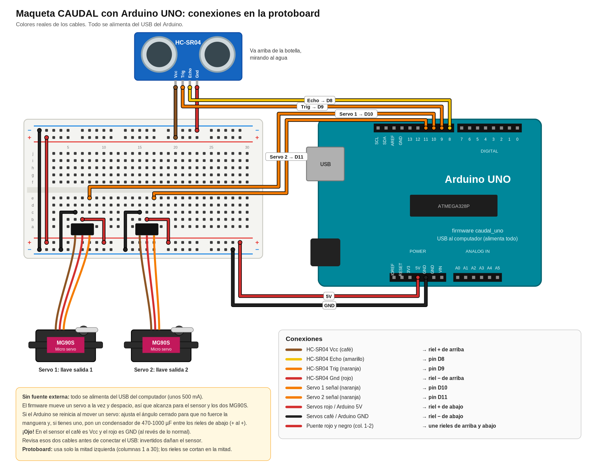
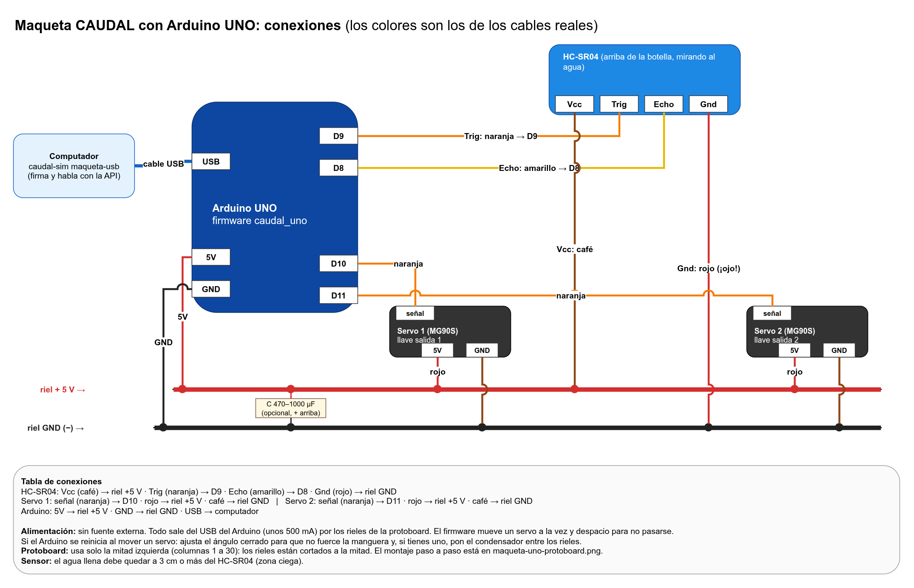
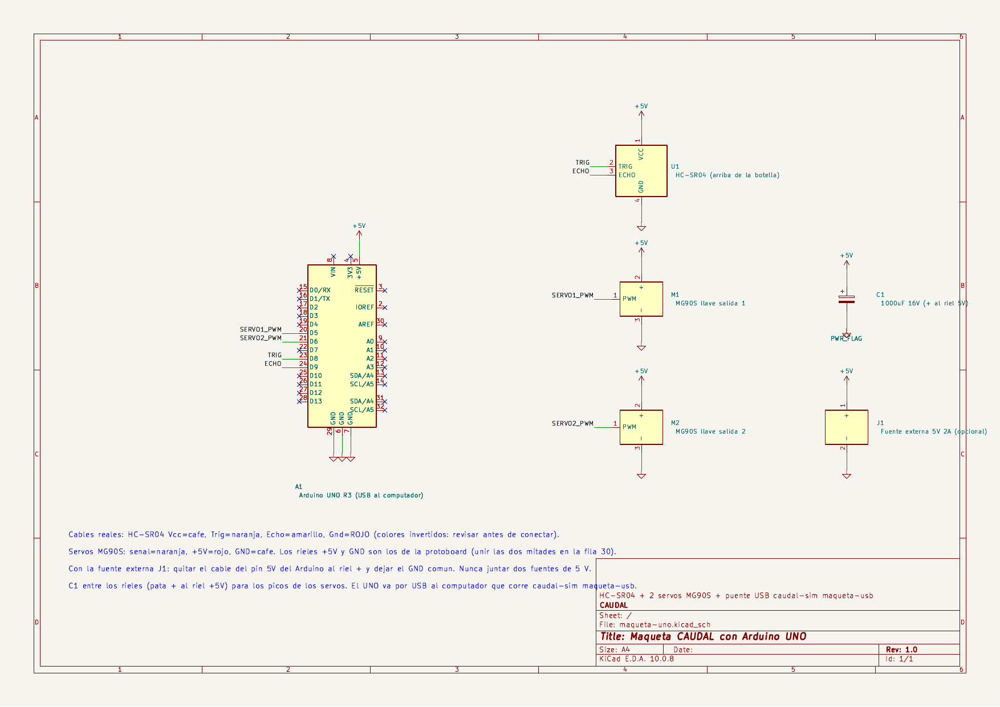

# Maqueta con Arduino UNO por USB

Variante de la maqueta para el banco de pruebas: una botella con dos salidas de manguera de suero, un **HC-SR04** arriba de la botella y dos **servos MG90S** que pisan la manguera de cada salida.

El UNO no tiene Wi-Fi ni memoria para firmar con Ed25519. Por eso no habla con la API: es un periférico USB que mide la distancia y mueve los servos. El computador al que está conectado corre el puente `caudal-sim maqueta-usb correr` de [`caudal-simulador`](https://github.com/NicoalsD/caudal-simulador). El puente hace lo mismo que el firmware del ESP32: firma, envía el nivel y consulta y confirma los comandos de las dos llaves. Hoy envía el nivel en metros cada 20 s (`LEVEL`). En el modelo B2B envía la distancia en mm (`DISTANCE`) cada ~2 s, y el backend convierte con la geometría del tanque (por implementar).

```
App CAUDAL ──> caudal-backend ──(comandos firmados)──> caudal-sim maqueta-usb ──USB──> Arduino UNO ──> servos
                     ^                                          │                          │
                     └──────────(telemetría LEVEL)──────────────┘<─────── distancia ────────┘ HC-SR04
```

## 1. Conexiones

Montaje en la protoboard (colores reales de los cables, todo alimentado por el USB del Arduino):



Diagrama de bloques de las mismas conexiones:



Esquemático en KiCad 10 (`hardware/uno/maqueta-uno.kicad_sch`, con PDF y SVG). Cada etiqueta (`TRIG`, `ECHO`, `SERVO1_PWM`, `SERVO2_PWM`) y cada símbolo de +5V o GND con el mismo nombre es el mismo cable. El ERC no da errores. Para regenerarlo: `python3 hardware/uno/gen_schematic.py <carpeta de símbolos de KiCad>`.



| Componente | Cable | Va a |
|---|---|---|
| HC-SR04 Vcc | café | riel +5 V |
| HC-SR04 Trig | naranja | D9 |
| HC-SR04 Echo | amarillo | D8 |
| HC-SR04 Gnd | rojo | riel GND |
| Servo 1 señal | naranja | D10 |
| Servo 2 señal | naranja | D11 |
| Servos, rojo | rojo | riel +5 V |
| Servos, café | café | riel GND |
| Arduino 5V / GND | rojo / negro | riel + / riel − de abajo |
| Puentes en las columnas 1 y 2 | negro / rojo | unen los rieles de arriba con los de abajo |

- **El sensor tiene los colores al revés de la costumbre:** el café es Vcc y el rojo es Gnd. Antes de conectar el USB, revisa que el café llegue a 5V y el rojo a GND. Si se invierten, el sensor se daña.
- **Protoboard:** usa solo la mitad izquierda (columnas 1 a 30), porque en la de 830 puntos los rieles se cortan a la mitad. El sensor va a los rieles de arriba y los servos y el Arduino a los de abajo; dos puentes en las columnas 1 y 2 unen los rieles.
- **Alimentación:** no hay fuente externa: todo sale del USB del Arduino (unos 500 mA). El firmware mueve un solo servo a la vez y despacio (1 grado cada 8 ms) para no pasarse. Si el Arduino se reinicia al mover un servo, ajusta el ángulo cerrado para que no fuerce la manguera y, si tienes uno, pon un condensador de 470 a 1000 µF entre los rieles de abajo (la pata + al riel +).
- **Sensor:** va arriba de la botella, centrado y mirando al agua. El agua llena debe quedar a 3 cm o más del sensor, que es su zona ciega. La boca tiene que ser ancha: en un cuello angosto, el eco rebota en las paredes.
- **Servos:** cada uno pisa la manguera contra un tope fijo (por ejemplo, una pieza de madera pegada). Cerrado basta con que no gotee: forzarlo calienta el servo y consume corriente.

## 2. Cargar el firmware

Con PlatformIO:

```bash
cd uno
pio run -t upload
pio device monitor        # debe mostrar: READY caudal-uno 1.0.0
```

Con el Arduino IDE: abre `uno/caudal_uno/caudal_uno.ino`, elige la placa **Arduino Uno** y el puerto, y sube. Los pines están en `uno/caudal_uno/config.h` (Trig D9, Echo D8, servos D10 y D11: así ningún cable se cruza en la protoboard).

En el monitor serie (115200 baudios, fin de línea `\n`) se puede probar a mano:

| Comando | Respuesta |
|---|---|
| `PING` | `PONG` |
| `D` | `D 213`: distancia en mm (`D -1` si no hubo eco) |
| `S1 90` | `OK S1 90` y luego `DONE S1 90` cuando el servo llega |
| `R1` | `OK R1`: suelta el servo 1 |
| `INFO` | versión y último ángulo de cada servo |

En Linux, el puerto es `/dev/ttyACM0` (UNO original) o `/dev/ttyUSB0` (clon con CH340). Si sale "permiso denegado", agrega tu usuario al grupo `dialout` (`sudo usermod -aG dialout $USER`) y vuelve a iniciar sesión.

### Probar sin la placa (simulador)

`uno/sim/run.sh` corre el firmware real en un ATmega328P simulado (simavr) con un HC-SR04 y dos servos virtuales, y abre un puerto serie virtual en `uno/sim/.build/ttyUNO`. Necesita `arduino-cli core install arduino:avr` o PlatformIO para el compilador AVR.

```bash
uno/sim/run.sh                                   # deja la terminal mostrando los servos
echo 150 > uno/sim/.build/distance_mm            # en otra terminal: el agua a 150 mm (-1 = sin eco)
uv run caudal-sim maqueta-usb probar --puerto ../caudal-maqueta/uno/sim/.build/ttyUNO
```

Con ese mismo puerto funcionan `servo`, `calibrar` y `correr`.

## 3. Calibrar

Desde `caudal-simulador`. Hoy la calibración queda en `scenarios/maqueta-usb.yaml`. En el modelo B2B se hace desde la app (botones "usar lectura actual como vacío/lleno" y ángulos de cada válvula), y el CLI `calibrar` queda para banco (por implementar):

```bash
uv run caudal-sim maqueta-usb puertos                  # dónde está el Arduino
uv run caudal-sim maqueta-usb probar                   # distancia y nivel en vivo
uv run caudal-sim maqueta-usb servo 1 45               # mueve el servo 1 a 45 grados
uv run caudal-sim maqueta-usb calibrar                 # asistente: sensor y servos
```

El asistente pide:

1. **Botella vacía:** mide la distancia del sensor al fondo (`empty_distance_mm`).
2. **Botella llena hasta el máximo de uso:** mide la distancia al agua (`full_distance_mm`).
3. **Por cada servo:** escribes ángulos hasta que la manguera queda libre (abierto) y luego hasta que queda pisada sin gotear (cerrado).

Hoy el nivel que se envía a la API es `vacío − medido`, en metros, limitado entre 0 y `vacío − lleno`. En B2B el puente envía `DISTANCE` (mm) y el backend calcula el nivel (por implementar).

## 4. Conectar con la app

1. En el backend, la maqueta son tres dispositivos: el sensor del tanque (`LEVEL_SENSOR`) y un actuador por llave (`VALVE_ACTUATOR`), cada uno con su clave pública. Se registran igual que los de la maqueta virtual ([operacion-live.md, sección 7](https://github.com/NicoalsD/caudal-simulador/blob/develop/docs/operacion-live.md)), con las variables `CAUDAL_SIM_MAQUETA_*` en el `.env` del simulador.
2. Corre el puente:

   ```bash
   uv run caudal-sim maqueta-usb correr --api-url http://localhost:8080
   ```

   Al arrancar, los dos servos van a **cerrado**. Cada segundo se mide la distancia. Hoy el nivel se envía cada 20 s; en B2B la distancia se envía cada ~2 s como `DISTANCE` (mm), dentro del límite de 60 peticiones por minuto (por implementar). Cada 2 s, cada llave consulta sus comandos.
3. En la app, abre o cierra una válvula. En B2B, con los botones Abrir y Cerrar de Inicio; hoy, con el diálogo de la llave en el acueducto en vivo. También puede actuar el piloto automático. El servo se mueve y el backend recibe el `ACKED`. Si el UNO no confirma la posición en `max_travel_seconds`, la llave queda en `FAULT` y el comando responde `FAILED`.
